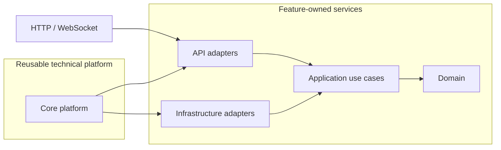

# base-fastApi

**Build business APIs. Keep the backend platform out of your way.**

A production-minded FastAPI foundation for teams that need more than a demo scaffold: modular service boundaries, secure authentication, explicit lifecycle management, optional AI infrastructure, and a serious quality toolchain — without forcing a database, Redis, or cloud provider on day one.

[](https://www.python.org/)
[](https://fastapi.tiangolo.com/)
[](LICENSE)

> Start as a modular monolith. Preserve the boundaries that let services evolve independently later.

## Why this exists

Most FastAPI starters help you create an endpoint. The expensive work starts after that: authentication, configuration, storage, database lifecycle, health diagnostics, consistent errors, service discovery, safe AI access, tests, and deployment conventions.

base-fastApi provides that platform layer up front while keeping business code in feature-owned services.

| Typical starter | base-fastApi |
| --- | --- |
| Routers, schemas, and a Dockerfile | A reusable technical platform plus explicit service boundaries |
| One hard-wired database path | PostgreSQL, MySQL, or SQLite — and database-free startup by default |
| Authentication added later | JWKS or HMAC JWT validation, normalized claims, RBAC, and resource ACLs |
| Infrastructure created at import time | Lazy providers and lifespan-owned startup/shutdown |
| AI calls scattered through business code | Optional, policy-controlled AI infrastructure behind service-owned ports |
| Happy-path health endpoint | Liveness, readiness, dependency probes, and service startup diagnostics |

## What you get

### A platform your services can reuse

- **Authentication and authorization** — JWKS or HMAC JWT validation, Keycloak-style role extraction, role hierarchy, FastAPI guards, and Linux-style per-resource ACLs.
- **Data access** — async SQLAlchemy sessions, Alembic integration, explicit transaction ownership, and PostgreSQL/MySQL/SQLite support.
- **Storage** — one application-facing contract with filesystem and S3-compatible implementations, path validation, namespacing, and lazy provider creation.
- **Cache and realtime** — in-process defaults with optional Redis-backed cache and WebSocket Pub/Sub.
- **Email** — console or SMTP delivery with optional Celery enqueueing and direct-delivery fallback.
- **HTTP safety** — request IDs, structured logging, request/upload limits, security headers, rate limiting, CORS, and a unified error envelope.
- **Operations** — readiness and liveness endpoints, startup probes, migration policy, runtime diagnostics, and deterministic resource cleanup.
- **Service discovery** — add a cohesive capability through `services/<name>/integration.py`; routers and lifecycle hooks are discovered and registered consistently.

### AI infrastructure that starts private

Core AI is optional and disabled by default. It provides internal building blocks for:

- Ollama, OpenAI-compatible endpoints, OpenAI, Anthropic, Google, and OpenRouter;
- typed output, streaming, embeddings, ingestion, retrieval, agents, tools, MCP, workflows, and evaluations;
- provider/model registries with capability-aware routing;
- tenant-aware memory and vector-store contracts;
- explicit tool permissions, approval gates, endpoint allowlists, timeouts, concurrency limits, and secret-safe telemetry.

Cloud transmission, cloud fallback, prompt storage, and response storage are all opt-in. Core AI exposes Python APIs, not an accidental public AI endpoint.

[Explore the Core AI architecture →](src/app/core/core_ai/README.md)

## Architecture



The dependency rule is simple: business logic does not depend on FastAPI, SQLAlchemy, provider SDKs, or concrete infrastructure. Services consume stable Core contracts through their own application ports.

### Architecture gallery

- [System architecture](docs/diagrams/system-architecture.html) — how requests cross the FastAPI boundary into feature-owned services and reusable Core capabilities.
- [Request lifecycle](docs/diagrams/request-lifecycle.html) — where transport, authorization, business policy, and infrastructure ownership change hands.
- [AI safety layers](docs/diagrams/ai-safety-layers.html) — the enforcement surfaces that keep provider access, tools, data movement, and telemetry bounded.

```text
src/app/
├── asgi.py                 # ASGI entrypoint
├── views.py                # application composition and lifespan
├── config.py               # validated environment settings
├── core/                   # auth, DB, AI, storage, cache, channels, email, ...
├── shared/                 # stable cross-service contracts
└── services/               # independently organized business capabilities
```

[Read the Core module map →](src/app/core/README.md) · [Read the service architecture guide →](src/app/services/README.md)

## Quick start

### Requirements

- Python 3.12+
- [`uv`](https://docs.astral.sh/uv/)
- [`just`](https://just.systems/)

```bash
git clone https://github.com/amariwan/base-fastApi.git
cd base-fastApi
uv sync --group dev
just dev
```

The database and AI platform are disabled by default, so the application can start without external infrastructure or credentials.

- OpenAPI UI: [http://localhost:5000/api/docs](http://localhost:5000/api/docs)
- Liveness: [http://localhost:5000/health/live](http://localhost:5000/health/live)
- Readiness: [http://localhost:5000/health/ready](http://localhost:5000/health/ready)

For a configured environment:

```bash
cp .env.example .env
# Review the example values before starting; they are placeholders, not production defaults.
just dev
```

## Add a business service

Services are discovered through `src/app/services/<name>/integration.py`. A registration can expose routers, startup hooks, shutdown hooks, and a redacted runtime-configuration view.

```python
from app.core.core_extensions import ServiceRegistration

from .api.router import router


def register_service() -> ServiceRegistration:
    return ServiceRegistration(
        name="orders",
        routers=[router],
    )
```

Keep HTTP schemas in API adapters, orchestration in Application, business invariants in Domain, and SQLAlchemy/provider code in Infrastructure. The [service development guide](src/app/services/README.md) documents the full contract.

## Configuration philosophy

Every major platform capability is independently configurable. Useful local defaults require no network services; production integrations remain explicit.

| Capability | Default | Optional production path |
| --- | --- | --- |
| Database | Disabled | PostgreSQL, MySQL, or SQLite |
| Cache | In-process memory | Redis |
| WebSocket channels | Disabled | In-process or Redis Pub/Sub |
| Storage | Filesystem | S3-compatible object storage |
| Email | Console | SMTP and optional Celery |
| AI | Disabled | Local Ollama, compatible endpoint, or allowlisted cloud provider |

See [`.env.example`](.env.example) for the complete configuration surface.

## Quality workflow

```bash
just test-unit          # fast isolated tests
just test-integration   # integration coverage
just test-e2e           # HTTP/application flows
just lint               # Ruff lint + format check
just mypy               # static typing
just pyright            # independent type analysis
just test-cov           # coverage report and 75% gate
just check              # complete local quality gate
```

The local quality workflow uses pytest, Ruff, Mypy, Pyright, `uv`, and `just`. External AI/model integrations remain opt-in so normal tests do not require credentials or a running model server.

## Honest boundaries

This repository is a foundation, not a finished product. It deliberately does not invent your domain model, tenant rules, persistence schema, API versioning policy, or deployment topology. Core AI does not claim a persistent vector database, durable conversation store, or public inference API. Those belong to concrete product requirements and service-owned adapters.

That constraint is a feature: the platform gives teams strong defaults without hiding product decisions inside a generic framework.

## Contributing

Issues and pull requests are welcome. Before proposing a new abstraction, check whether a focused service implementation or an existing Core contract already solves the problem.

1. Fork the repository.
2. Create a focused branch.
3. Add behavior-focused tests.
4. Run the relevant quality checks.
5. Open a pull request that explains the contract and compatibility impact.

## License

Released under the [MIT License](LICENSE).
